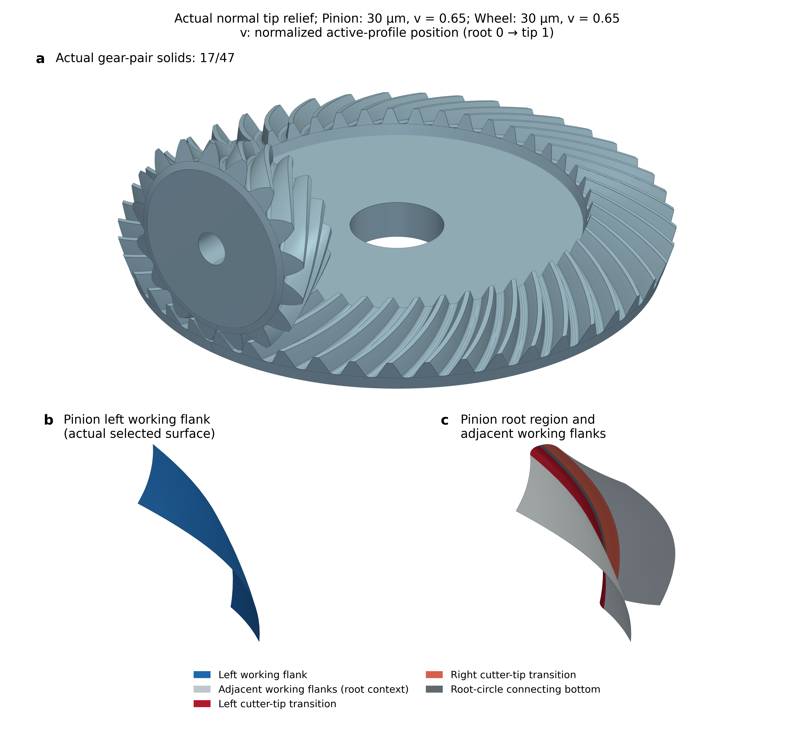
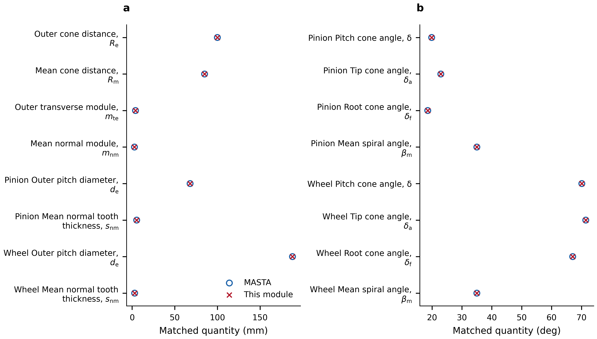
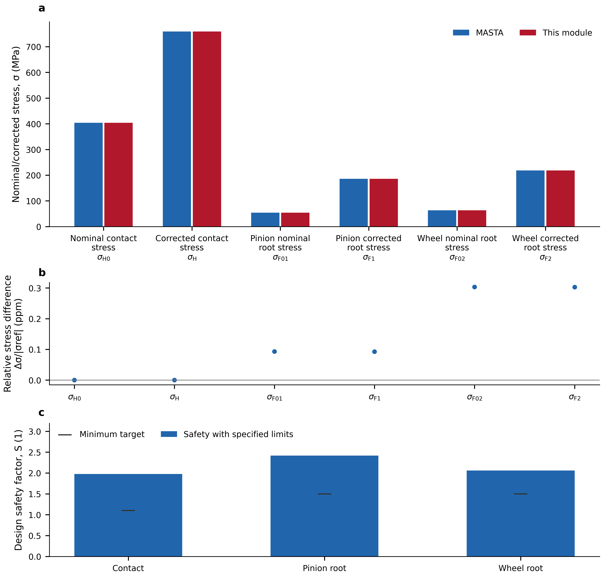
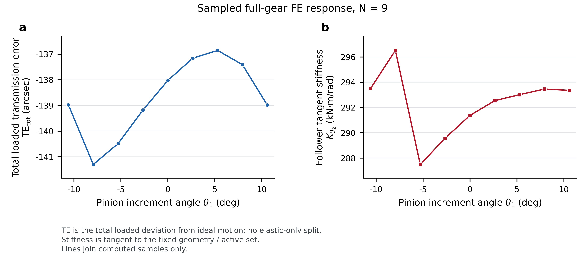
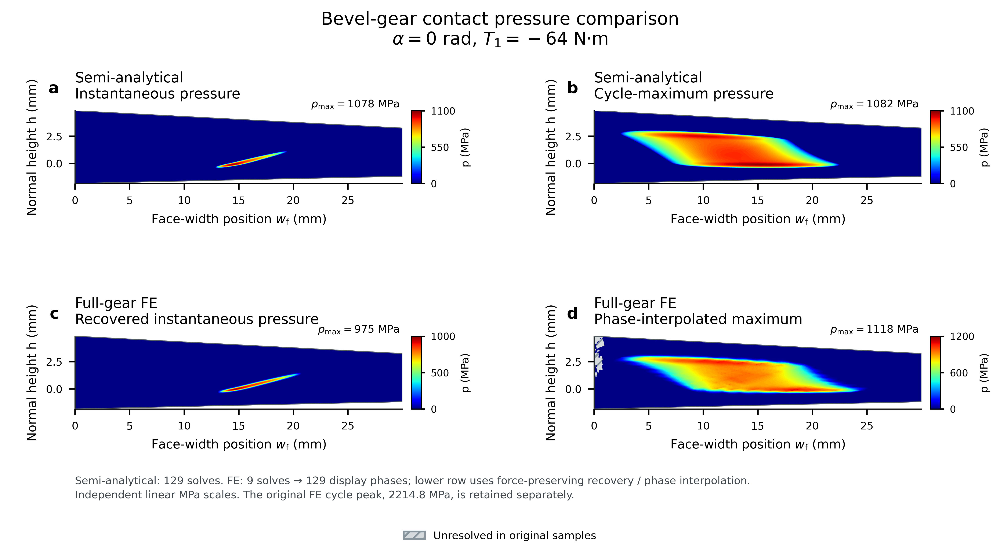

# Bevel Gear Design

[中文](README.md) · [English](README.en.md)

[](https://www.python.org/) [](LICENSE)

Independent Python tools for zero-offset straight and spiral bevel gears: geometry, mesh forces, actual tooth surfaces and full-gear CAD, standard strength assessment, unloaded tooth contact analysis (TCA), and loaded tooth contact analysis (LTCA). Calculation functions can be integrated directly into other programs.

## Contents

- [Installation and API](#installation-and-api)
- [Capabilities](#capabilities)
- [17/47 spiral bevel gear example](#1747-spiral-bevel-gear-example)
- [Reproduction and verification](#reproduction-and-verification)
- [Scope](#scope)
- [Current release and roadmap](#current-release-and-roadmap)
- [Documentation and layout](#documentation-and-layout)

## Installation and API

Requires Python 3.10 or newer. Run from the project root:

```bash
python -m pip install -e ".[plots]"
python examples/run_spiral_workflow.py examples/spiral_17_47_case.json --reference examples/spiral_17_47_reference.json --through strength --output output/spiral_17_47 --plots
```

For nominal geometry, mesh forces and standard strength only, use `python -m pip install -e .`; numerical and CAD dependencies are unnecessary. Actual surfaces, three-dimensional modeling and FE contact additionally require:

```bash
python -m pip install -e ".[ltca,plots,render3d]"
```

The calculation functions are also directly accessible:

```python
from bevel_gear.workflow import load_bevel_case, analyze_bevel_case

case = load_bevel_case("examples/spiral_17_47_case.json")
result = analyze_bevel_case(case, "output/design", through="strength")
print(result["strength_assessment"])
```

Public interfaces use SI units: m, rad, N, Pa and N·m; fields marked `rpm` use r/min. Contact torque retains its working-flank sign. Follower-shaft tangent rotational stiffness uses N·m/rad.

## Capabilities

| Module | Capabilities |
|---|---|
| Geometry and loading | Pitch cones, outer/mean/inner dimensions, tooth thickness and height, contact ratios, and tangential, radial and axial forces |
| Tooth surfaces and CAD | Spherical-involute straight flanks with engineering root connections; cutter-generated spiral flanks and cutter-tip root transitions; bored full gears, assembly and STEP/BREP export |
| Standard strength | Implemented ISO 10300 B1/B2 and AGMA 2003 branches, plus a separate 2014 nominal-stress chain; stresses, safety factors and supported capacity/life calculations |
| Unloaded TCA | Tangency on actual finite flanks, contact tracks and unloaded transmission error |
| Full-gear FE-LTCA | Three-dimensional linear elasticity on complete spiral working flanks, tooth/body flexibility, cross-tooth coupling, nonnegative pressure and torque equilibrium |
| Local semi-analytical contact | Actual finite flanks, analytical rectangular-element half-space compliance, nonnegative pressure constraints and local closure |
| Results and postprocessing | Total loaded TE, tangent stiffness, tooth-pair load sharing, instantaneous/cycle-maximum pressure, SI data and bilingual figures |

See [Model definitions](docs/model.md) and [API reference](docs/api.md) for inputs, model assumptions and output definitions.

## 17/47 spiral bevel gear example

A 17/47 pair illustrates nominal design, actual tooth modeling, standard strength and contact analysis. The [reproduction guide](docs/examples.md) lists inputs and commands for each stage.

| Parameter | Value |
|---|---:|
| Pinion/wheel teeth z₁/z₂ | 17/47 |
| Outer transverse module mₑ | 4 mm |
| Wheel outer pitch diameter dₑ₂ | 188 mm |
| Face width b | 29.988 mm |
| Shaft angle Σ | 90° |
| Nominal mean spiral angle βₘ | 35° |
| Pinion torque T₁ in contact analysis | −64 N·m |
| Speed magnitude | 1500 r/min |
| Young's modulus E / Poisson's ratio ν | 210 GPa / 0.3 |
| FE support | Fixed bore walls on both gears |

### Tooth surfaces and full-gear models

The contact case applies 30 μm of normal tip relief to both actual flanks, starting at normalized profile position v=0.65 with a C² quintic law. Here v=0 denotes the root and v=1 the tip. Relief is included in the working surfaces and closed solids.



Colors identify working flanks, cutter-tip transitions and connecting root bottoms; they do not represent pressure.

### Geometry and standard-strength comparisons

Key dimensions, standard stresses and design safety factors are compared with saved MASTA references for the same nominal inputs and quantity definitions. Safety factors use the case's 1500/450 MPa contact/root design stress limits.





The nominal benchmark and relieved contact analysis use their respective manufacturing configurations; inputs and result scopes are listed in the [reproduction guide](docs/examples.md).

### TCA and LTCA cycle response

TCA solves position and normal tangency on actual finite working flanks. LTCA solves the loaded follower angle, pressure and tooth-pair load sharing for the specified phase and torque. The figure shows total loaded TE and follower-shaft tangent stiffness at nine actual FE solution phases; lines connect discrete computed samples.



TE is the difference between actual follower motion and ideal tooth-ratio motion. Kθ₂ is follower-shaft tangent rotational stiffness at the current geometry and loaded branch. Interfaces use rad and N·m/rad; the figure uses arcsec and kN·m/rad. Total TE is distinct from elastic-only TE.

### Instantaneous and cycle-maximum contact pressure

The panels show semi-analytical instantaneous pressure, semi-analytical cycle maximum, FE instantaneous pressure and FE cycle maximum, in that order. Each has an independent linear MPa colorbar: zero pressure is blue and high pressure is red. The exterior is white; regions unresolved in the original samples are gray-hatched.



The face-width coordinate w_f increases from heel to toe; h points toward the tip along the pitch-cone normal, both in mm. The quantity p is normal contact pressure. Instantaneous panels use the reference tooth pair at pinion phase α=0 rad. Cycle maps show the maximum experienced at each material position; colored area is not simultaneously loaded area.

The semi-analytical model uses 129 solved phases. The FE lower row applies force-preserving pressure recovery and phase interpolation from 9 solved to 129 display phases. It illustrates engineering distributions, without new FE equilibrium solves or a peak-pressure convergence claim, and is not intended for strength acceptance. The [raw pressure comparison](examples/results/relieved_contact/en/17_contact_composite_raw.png), numerical sources and [method description](docs/contact_pressure_display.md) are also supplied.

## Reproduction and verification

Supplied SI pressure and cycle-response data redraw the bilingual figures without CAD or another large FE solve:

```bash
python examples/replot_contact_composite.py --output output/contact --lang both
python examples/replot_native_response.py --output output/response --lang both
```

Straight-gear geometry/strength, small real-FE contact verification and the test suite:

```bash
python examples/run_spiral_workflow.py examples/straight_16_32_case.json --through strength --output output/straight
python examples/validate_native_contact.py --output output/native_contact_check.json
python -B -m unittest discover -s tests -v
```

Checks cover numerical geometry/strength comparisons, contact constraints, force/energy balance, original-response recomputation and postprocessing conservation. Numerical reproducibility and physical accuracy are assessed separately; contact-pressure experiments have not been performed. Full CAD, semi-analytical and full-gear FE commands are in the [reproduction guide](docs/examples.md).

## Scope

- Zero-offset, intersecting-axis straight and spiral bevel gears; hypoid gears are excluded.
- Contact is frictionless, quasi-static and small-deformation linear elastic. The current full-gear case fixes both bore walls and excludes bearing/housing flexibility, lubrication, temperature, plasticity and dynamic noise.
- The local semi-analytical model excludes finite-tooth, gear-body and cross-tooth compliance. Its local closure is not full-gear total TE; outputs from the two compliance models are not interchangeable.
- Standard strength requires explicit rating settings and material stress limits. Standard contact stress is distinct from spatial LTCA pressure. Complete-flank contact examples currently focus on spiral gears; straight-gear roots use engineering connections.
- Pressure recovery and phase interpolation are display estimates, with original results retained separately. No claim is made that the example's local FE peak pressure or continuous-phase maximum is converged.

## Current release and roadmap

- **0.10.0**: Straight/spiral geometry and standard strength, actual surfaces and CAD, TCA, spiral full-gear FE and local semi-analytical contact, and reproducible bilingual example figures.
- **Next release**: Partially covered boundary-cell contact, pressure/phase adaptivity, an unloaded full-gear FE tangency reference and elastic-only TE decomposition.
- **Later extensions**: Cutter-generated straight-gear roots and complete-flank contact workflows, broader installation-error and ease-off analysis, support flexibility and pressure experiments. These are planned features.

## Documentation and layout

[Model definitions](docs/model.md) · [API reference](docs/api.md) · [Example reproduction](docs/examples.md) · [FE cases](docs/native_fe_case.md) · [Pressure display](docs/contact_pressure_display.md)

`bevel_gear/` contains calculation and postprocessing modules; `examples/` contains inputs and runners, with selected results in `examples/results/`; `docs/` contains method and API documentation; `tests/` and `.github/` provide verification entry points.

Distributed under [AGPL-3.0-only](LICENSE). For closed-source integration, [contact the author](https://github.com/Lilililiyyy) about commercial licensing.
