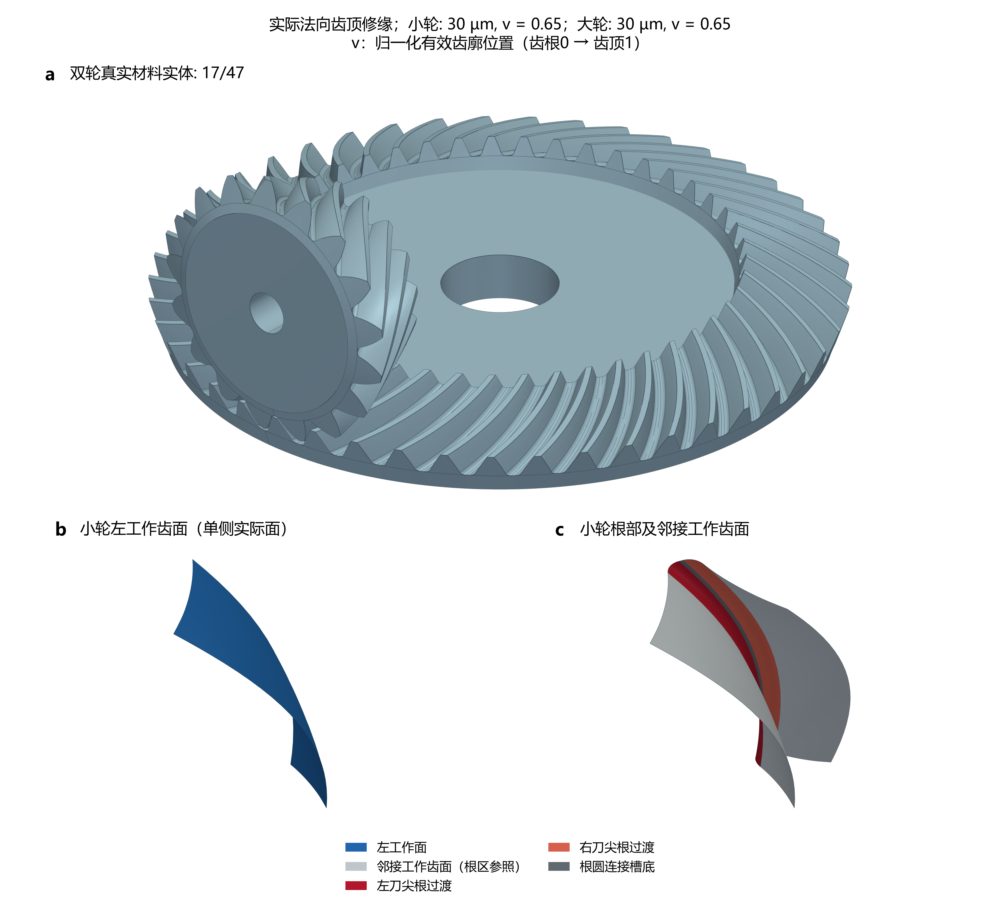
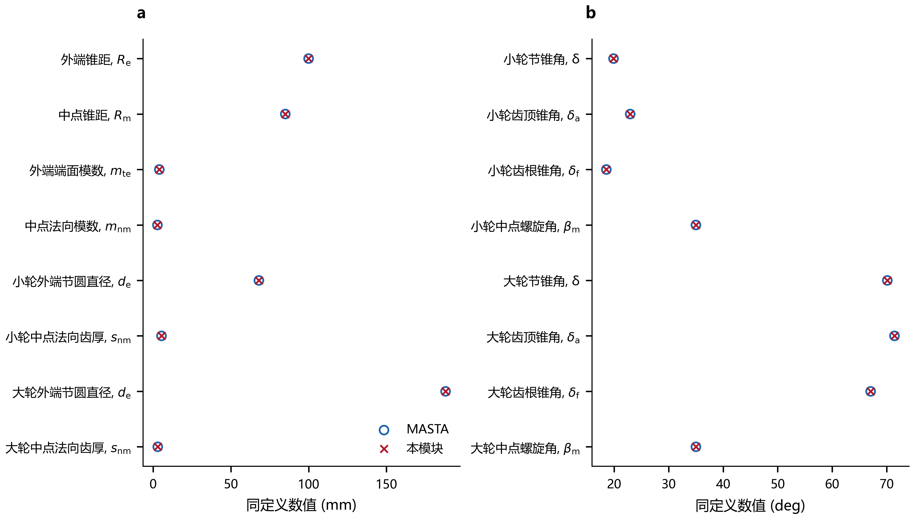
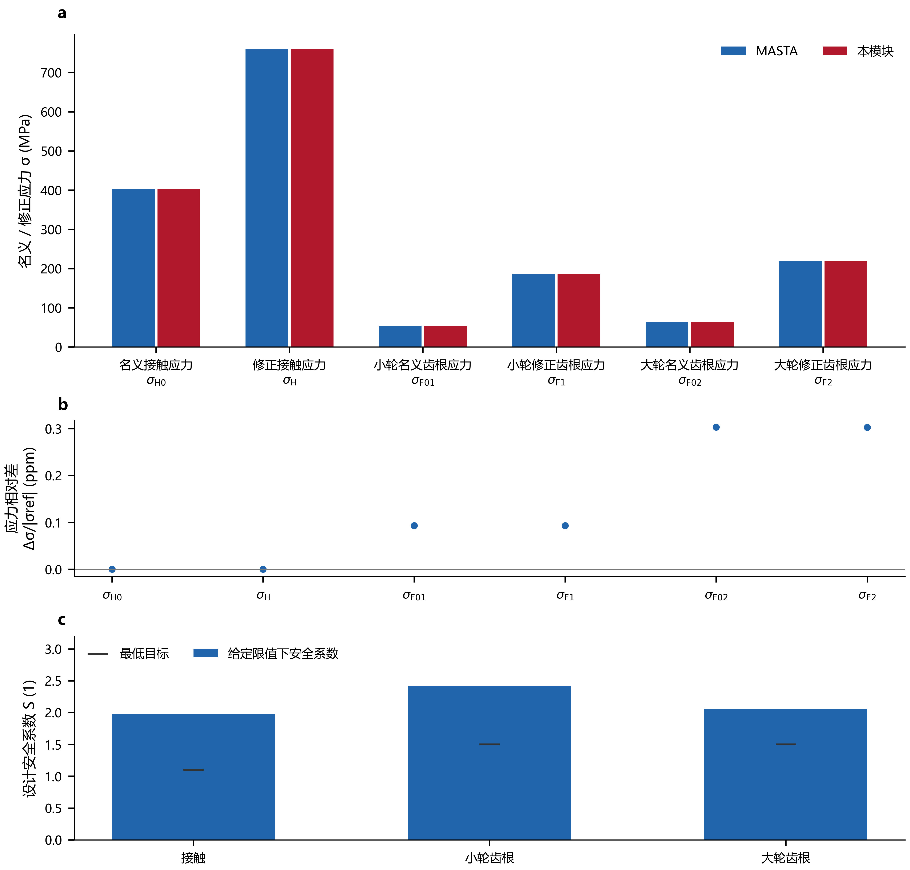
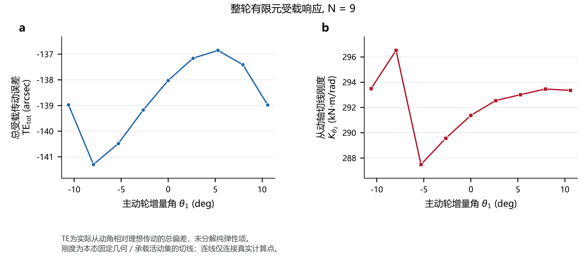
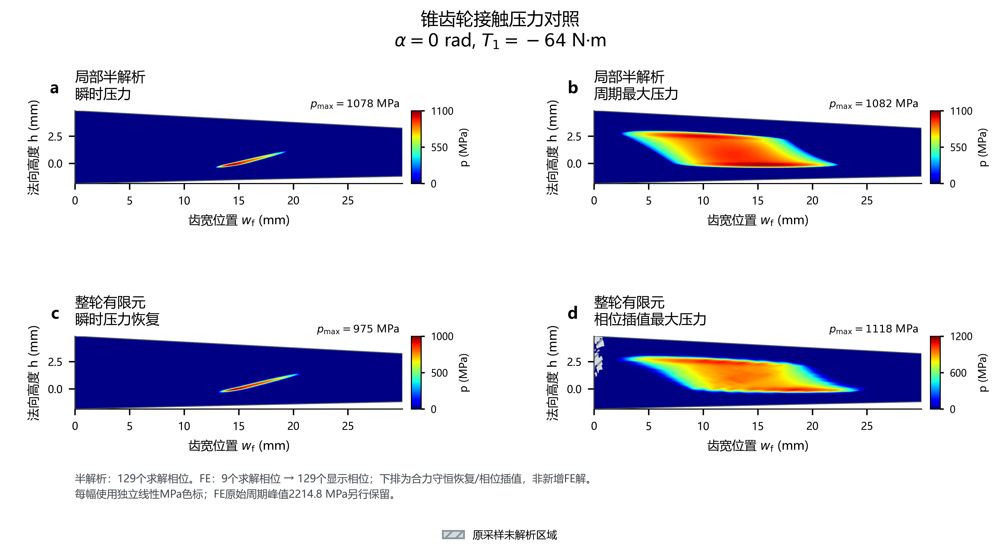

# Bevel Gear Design

[中文](README.md) · [English](README.en.md)

[](https://www.python.org/) [](LICENSE)

零偏置直齿与弧齿锥齿轮的独立 Python 设计分析项目，提供几何、啮合力、实际齿面与整轮建模、标准强度、无载齿面接触分析（TCA）及承载齿面接触分析（LTCA）。计算函数可直接集成到其他程序。

## 目录

- [安装与调用](#安装与调用)
- [计算能力](#计算能力)
- [17/47 弧齿锥齿轮案例](#1747-弧齿锥齿轮案例)
- [复现与验证](#复现与验证)
- [适用范围](#适用范围)
- [当前版本与后续计划](#当前版本与后续计划)
- [文档与文件组织](#文档与文件组织)

## 安装与调用

需要 Python 3.10 或更新版本。在项目根目录执行：

```bash
python -m pip install -e ".[plots]"
python examples/run_spiral_workflow.py examples/spiral_17_47_case.json --reference examples/spiral_17_47_reference.json --through strength --output output/spiral_17_47 --plots
```

仅使用名义几何、啮合力和标准强度时，执行 `python -m pip install -e .`，无需数值或 CAD 依赖。实际齿面、三维建模及 FE 接触另需安装：

```bash
python -m pip install -e ".[ltca,plots,render3d]"
```

也可直接调用计算函数：

```python
from bevel_gear.workflow import load_bevel_case, analyze_bevel_case

case = load_bevel_case("examples/spiral_17_47_case.json")
result = analyze_bevel_case(case, "output/design", through="strength")
print(result["strength_assessment"])
```

公开接口采用 SI 单位：长度 m、角度 rad、力 N、压力 Pa、扭矩 N·m；带 `rpm` 的字段使用 r/min。接触扭矩保留工作侧符号，从动轴切线扭转刚度使用 N·m/rad。

## 计算能力

| 模块 | 功能 |
|---|---|
| 几何与载荷 | 节锥、外端／中点／内端尺寸、齿厚与齿高、重合度，以及切向、径向和轴向啮合力 |
| 齿面与 CAD | 直齿球面渐开线与工程根连接；弧齿刀盘展成工作面与刀尖根过渡；有孔整轮、装配及 STEP/BREP 导出 |
| 标准强度 | 已实现的 ISO 10300 B1/B2、AGMA 2003 分支和独立 2014 名义应力链；应力、安全系数及支持分支的容量／寿命 |
| 无载 TCA | 实际有限工作面的相切位置、接触轨迹与无载传递误差 |
| 整轮 FE-LTCA | 弧齿完整工作面的三维线弹性、齿体／轮体柔度、多齿耦合、非负接触压力及扭矩平衡 |
| 局部半解析接触 | 实际有限齿面、矩形面元解析半空间柔度、非负压力约束及局部闭合量 |
| 结果与后处理 | 总受载 TE、切线刚度、齿对分载、瞬时／周期最大压力，SI 数值导出及中英图表 |

输入参数、模型定义与各路线的输出含义见[模型说明](docs/model.md)和[接口说明](docs/api.md)。

## 17/47 弧齿锥齿轮案例

以一组 17/47 弧齿副展示从名义设计、实际齿面建模、标准强度到接触分析的工作流程。[案例复现指南](docs/examples.md)列出各阶段的输入与运行命令。

| 参数 | 数值 |
|---|---:|
| 小轮／大轮齿数 z₁／z₂ | 17／47 |
| 外端端面模数 mₑ | 4 mm |
| 大轮外端节径 dₑ₂ | 188 mm |
| 齿宽 b | 29.988 mm |
| 轴交角 Σ | 90° |
| 名义中点螺旋角 βₘ | 35° |
| 接触分析主动轮扭矩 T₁ | −64 N·m |
| 转速幅值 | 1500 r/min |
| 弹性模量 E／泊松比 ν | 210 GPa／0.3 |
| FE 支承 | 两轮孔壁固定 |

### 齿面与整轮建模

接触案例在两轮实际齿面上施加 30 μm 法向齿顶修缘，从归一化齿廓位置 v=0.65 开始，采用 C² 连续五次函数；v=0 为齿根，v=1 为齿顶。修缘进入工作齿面和闭实体。



图中颜色区分工作齿面、刀尖过渡与连接齿底，不表示压力。

### 几何与标准强度对标

采用相同名义输入与量定义，与保存的 MASTA 参照比较关键几何尺寸、标准应力及设计安全系数。安全系数使用案例给定的 1500/450 MPa 接触／齿根设计应力限值。





名义设计对标与修缘接触分析分别使用其制造配置，输入与适用结果见[案例复现指南](docs/examples.md)。

### TCA 与 LTCA 周期响应

TCA 在实际有限工作面求对应位置与法向相切；LTCA 在给定相位和扭矩下求受载从动角、压力与齿对分担。下图给出九个实际 FE 求解相位的总受载 TE 及从动轴切线刚度，连线连接离散计算点。



TE 为实际从动角与理想齿数比运动的差；Kθ₂ 为当前几何及承载分支下的从动轴切线扭转刚度。接口分别使用 rad、N·m/rad，图中换算为角秒（arcsec）、kN·m/rad。这里的总 TE 不等同于纯弹性 TE。

### 瞬时与周期最大接触压力

四图依次为半解析瞬时压力、半解析周期最大压力、FE 瞬时压力和 FE 周期最大压力，各自使用独立线性 MPa 色标。零压为蓝，高压为红；齿面外为白，原采样未解析域为灰色网纹。



w_f 为从外端向内端增加的齿宽位置，h 为沿节锥法向朝齿顶的高度，均用 mm；p 为法向接触压力。瞬时图取主动轮相位 α=0 rad 的参考齿对。周期图表示各材料位置经历的最大压力，其彩色面积不等同于同时承载面积。

半解析采用 129 个求解相位。FE 下排采用合力守恒压力恢复及相位插值，由 9 个求解相位生成 129 个显示相位，仅用于工程分布展示，不代表新增 FE 平衡解或峰压收敛验证，不能用于强度验收。[原始压力图](examples/results/relieved_contact/zh/17_contact_composite_raw.png)、数值源和[方法说明](docs/contact_pressure_display.md)同时提供。

## 复现与验证

随附 SI 压力和周期响应数据，可直接重绘上述中英图表，无需 CAD 或重新进行大型 FE 求解：

```bash
python examples/replot_contact_composite.py --output output/contact --lang both
python examples/replot_native_response.py --output output/response --lang both
```

直齿几何／强度案例、小型真实 FE 接触验证与测试入口：

```bash
python examples/run_spiral_workflow.py examples/straight_16_32_case.json --through strength --output output/straight
python examples/validate_native_contact.py --output output/native_contact_check.json
python -B -m unittest discover -s tests -v
```

现有检查覆盖几何与强度数值对标、接触约束、力／能量平衡、原始响应复算及后处理守恒。数值复现与物理精度分别评价；尚无接触压力实验验证。CAD、半解析接触及整轮 FE 的完整复算入口见[案例指南](docs/examples.md)。

## 适用范围

- 面向零偏置、相交轴的直齿与弧齿锥齿轮，不包含准双曲面齿轮。
- 接触模型采用无摩擦、准静态、小变形线弹性假设；当前整轮 FE 案例固定两轮孔壁，不含轴承／箱体、润滑、温升、塑性或动态噪声。
- 局部半解析不包含有限齿体、轮体及跨齿柔度，其局部闭合量不能作为整轮总 TE；两种柔度模型的结果不能直接互换。
- 标准强度需显式给定评级设置和材料应力限，标准接触应力不等同于 LTCA 空间压力。当前完整工作面接触案例集中于弧齿，直齿齿根采用工程连接。
- 压力恢复与相位插值属于显示估计，原始结果单独保留；未宣称弧齿案例的局部峰压或连续相位最大值已收敛。

## 当前版本与后续计划

- **0.10.0**：提供直齿／弧齿几何与标准强度、实际齿面和 CAD、TCA、弧齿整轮 FE 与局部半解析接触，以及可复现的双语案例图表。
- **下一版本**：边缘部分面元接触、压力／相位自适应，以及整轮 FE 无载相切参考与纯弹性 TE 分解。
- **后续扩展**：直齿刀具展成齿根及完整工作面接触流程、更完整的安装误差与 ease-off、支承柔度和压力实验验证。以上均为计划。

## 文档与文件组织

[模型说明](docs/model.md) · [接口说明](docs/api.md) · [案例复现](docs/examples.md) · [FE 案例](docs/native_fe_case.md) · [压力显示](docs/contact_pressure_display.md)

`bevel_gear/` 保存计算与后处理模块；`examples/` 保存输入和运行脚本，`examples/results/` 保存精选结果；`docs/` 提供方法与接口文档；`tests/` 和 `.github/` 提供验证入口。

本项目采用 [AGPL-3.0-only](LICENSE)。如需闭源集成，可[联系作者](https://github.com/Lilililiyyy)获取商业授权。
